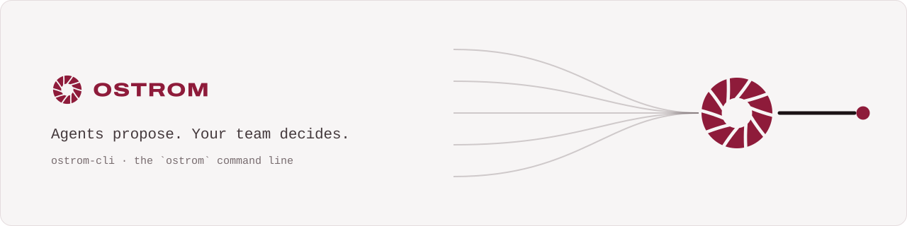
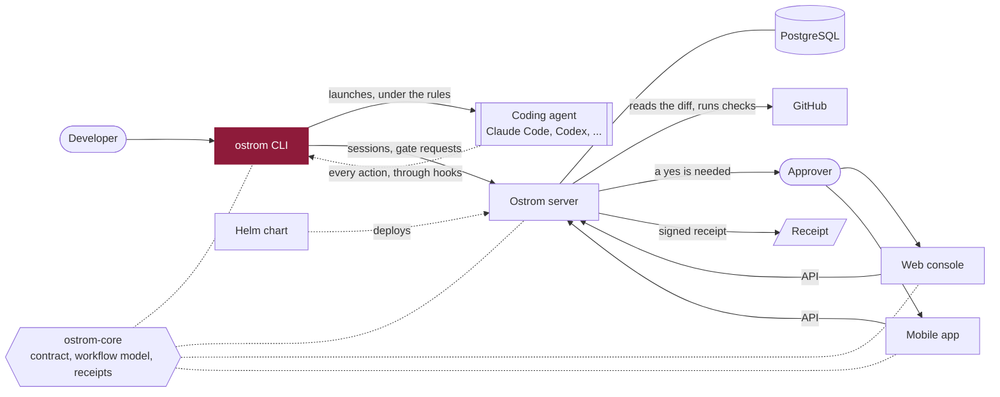

<p align="center">
  <a href="https://ostrom.run">
    <picture>
      <source media="(prefers-color-scheme: dark)" srcset=".github/assets/banner-dark.svg">
      
    </picture>
  </a>
</p>

<p align="center">
  <strong>Ostrom runs a company's AI coding agents in the cloud and makes them follow the team's rules.</strong><br>
  Every change they make leaves a receipt, and the few that matter wait for a person's yes.
</p>

<p align="center">
  <a href="https://ostrom.run">Website</a> ·
  <a href="https://ostrom.run/docs">Docs</a> ·
  <a href="https://github.com/ostrom-hq/ostrom-cli/discussions">Discussions</a> ·
  <a href="CONTRIBUTING.md">Contributing</a> ·
  <a href="SECURITY.md">Security</a>
</p>

<p align="center">
  <a href="https://github.com/ostrom-hq/ostrom-cli/actions/workflows/ci.yml"></a>
  <a href="CONTRIBUTING.md#tests-the-bar"></a>
  <a href="LICENSE"></a>
  <a href="CHANGELOG.md"></a>
</p>

## What this is

`ostrom`, the command line of Ostrom: start a coding agent under your team's harness, answer approvals, verify
receipts. One Kotlin/Native binary for macOS (arm64), Linux (x64, arm64) and Windows (x64).

```
ostrom                       home screen
ostrom run claude            start Claude Code under the harness (also codex, opencode, gemini, grok, hermes, pi)
ostrom run claude -- -p hi   everything after -- goes to the agent as it is
ostrom doctor                check this device
ostrom --help                every command
```

## Quick start

```sh
git clone https://github.com/ostrom-hq/ostrom-cli.git && cd ostrom-cli
./gradlew jvmTest koverVerify     # the common tests and their 100 % coverage
./gradlew linuxX64Test            # natively; on a Mac: ./gradlew macosArm64Test
```

## How it fits



## Status

Ostrom is before its first public release.

| Part | Status |
| --- | --- |
| `version`, `doctor`, `config`, the home screen | Available |
| `init`, `invite`, `members`, `policy`, `harness`, `waits` | Available; what the server does not serve yet is said, not failed |
| The other commands of the spec | Declared with their help; they exit with 70 (`not implemented yet`) while they are built |
| Released binaries | At the launch |

## Development

- Modules, and how to add a command or an agent adapter: [docs/MODULES.md](docs/MODULES.md).
- How `ostrom login`, `ostrom doctor` and `ostrom update` check the server's API and features:
  [docs/COMPATIBILITY.md](docs/COMPATIBILITY.md).
- CI builds and tests every target (`.github/workflows/ci.yml`). Locally: `./gradlew jvmTest koverVerify` for the
  common tests and their coverage, `./gradlew linuxX64Test` or `./gradlew macosArm64Test` natively.

## Repositories

| Repository | What it is | License |
| --- | --- | --- |
| [ostrom-core](https://github.com/ostrom-hq/ostrom-core) | Shared Kotlin Multiplatform library: API contract, workflow model, signed receipts | Apache-2.0 |
| **ostrom-cli** (this one) | The `ostrom` command line: runs coding agents under the team's rules | Apache-2.0 |
| [ostrom-server](https://github.com/ostrom-hq/ostrom-server) | The server: gates, receipts, policies, the API | AGPL-3.0 + ee |
| [ostrom-web](https://github.com/ostrom-hq/ostrom-web) | The web console | AGPL-3.0 + ee |
| [ostrom-app](https://github.com/ostrom-hq/ostrom-app) | The iOS and Android app | AGPL-3.0 + ee |
| [ostrom-e2e](https://github.com/ostrom-hq/ostrom-e2e) | Full-stack end-to-end and load tests | Apache-2.0 |
| [ostrom-site](https://github.com/ostrom-hq/ostrom-site) | ostrom.run: website, documentation, blog | Apache-2.0 |
| [ostrom-helm](https://github.com/ostrom-hq/ostrom-helm) | Helm chart and Docker Compose for self-hosting | AGPL-3.0 |

## Contributing

Contributions are welcome. Read [CONTRIBUTING.md](CONTRIBUTING.md) (setup, tests, Conventional Commits, DCO), the
[Code of Conduct](CODE_OF_CONDUCT.md), and [SECURITY.md](SECURITY.md) to report a vulnerability privately. Questions
go to [Discussions](https://github.com/ostrom-hq/ostrom-cli/discussions); help options are in [SUPPORT.md](SUPPORT.md).

## License

Apache License 2.0, see [LICENSE](LICENSE) and [NOTICE](NOTICE). You can use it in any project, open source or not.
